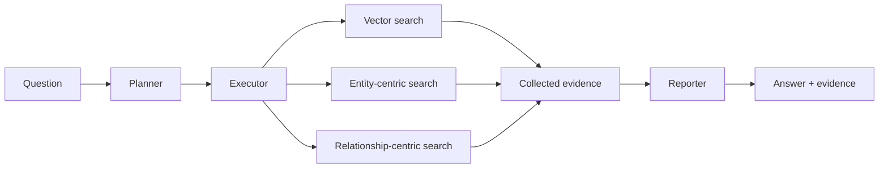

<h1 align="center">ModeRAG</h1>

<p align="center"><strong>Agentic RAG with vector and graph retrieval.</strong></p>

<p align="center">
  <a href="https://huggingface.co/datasets/PKUfudawei/LHCpublications"></a>
  <a href="https://huggingface.co/datasets/PKUfudawei/AI4EIC2023"></a>
  <a href="pyproject.toml">=3.10"></a>
  <a href="LICENSE"></a>
</p>

<p align="center">
  <strong>English</strong> · <a href="README.zh-CN.md">简体中文</a>
</p>

## Table of Contents

- [Overview](#overview)
- [Installation](#installation)
- [Quick Start](#quick-start)
  - [1. Configure your LLM](#1-configure-your-llm)
  - [2. Download an example index](#2-download-an-example-index)
  - [3. Ask a question](#3-ask-a-question)
- [How It Works](#how-it-works)
- [Configuration](#configuration)
- [Datasets](#datasets)
  - [Index your documents](#index-your-documents)
- [Evaluation](#evaluation)
- [Repository Layout](#repository-layout)
- [Documentation](#documentation)
- [License](#license)

---

## Overview

ModeRAG is a Python framework that breaks questions into retrieval tasks, assigns each task a vector, entity-centric, or relationship-centric search mode, and combines the retrieved evidence into an answer. Use it to explore document collections, compare information across sources, and inspect the evidence behind a response.

- **Task planning:** decompose questions and assign retrieval modes to sub-queries.
- **Vector and graph retrieval:** search passages, entities, and relationships in a shared indexed corpus.
- **Parallel execution:** run independent tasks concurrently while respecting declared dependencies.
- **Evidence inspection:** inspect retrieved content, task records, and structured evidence in the report.
- **Two report modes:** choose a concise answer or a detailed report with evidence references.

## Installation

Requires Python 3.10 or newer. The current dependency list includes `faiss-gpu-cu12`; use a compatible Linux/CUDA environment. Embeddings run locally with `BAAI/bge-m3` and may download model weights on first use.

```bash
git clone https://github.com/PKUfudawei/ModeRAG.git
cd ModeRAG
python -m venv .venv
source .venv/bin/activate
python -m pip install -e .
```
The project is called **ModeRAG**. The Python distribution and import package are both named `moderag`.

## Quick Start

Run the following steps from the repository root with the virtual environment active.

### 1. Configure your LLM

Set an API key and an OpenAI-compatible model endpoint:

```bash
export LLM_MODE=openai
export LLM_MODEL=gpt-4o-mini
export LLM_BASE_URL=https://api.openai.com/v1
export LLM_API_KEY="your-api-key"
```
For another compatible provider, replace the model, base URL, and key with its values. Set `LLM_MODE` explicitly: the library otherwise defaults to an internal Tencent profile.

### 2. Download an example index

Use the prebuilt vector and graph indexes from [LHC Publications](https://huggingface.co/datasets/PKUfudawei/LHCpublications). The `hf` CLI is provided by `huggingface_hub`, a dependency of the embedding stack.

```bash
hf download PKUfudawei/LHCpublications --repo-type dataset \
  --include "indexes/*" --local-dir ./data/lhcpublications
```
This places `graph.pkl`, `entities.pkl`, `relationships.pkl`, and `vectorstore/` under `data/lhcpublications/indexes/`. The full document corpus is not needed for this example.

### 3. Ask a question

Register the three retrieval tools against the downloaded index, then run the pipeline:

```python
from functools import partial

from moderag.agents import ReportMode, get_orchestrator
from moderag.agents.tools.registry import SearchModeTool, ToolRegistry

index_path = "./data/lhcpublications/indexes"
for mode in ("naive", "local", "global"):
    ToolRegistry.register(
        mode,
        partial(SearchModeTool, mode=mode, storage_path=index_path),
    )

orchestrator = get_orchestrator(report_mode=ReportMode.CONCISE)
result = orchestrator.process_query(
    "How do ATLAS and CMS study Higgs boson production?"
)

if not result.success:
    raise RuntimeError(result.error)

print(result.answer)
print(result.report.structured_evidence)
```
`result.plan` contains the task plan; `result.to_dict()` exports the answer, report, plan, and execution statistics. To request a detailed report, use `ReportMode.REASONING`.

Tool registration is process-wide. Configure it before creating the orchestrator, and use the same embedding model as the one used to build the index.

## How It Works


| Stage | Responsibility |
|---|---|
| Planner | Creates sub-queries, assigns retrieval tools, and declares task dependencies. |
| Executor | Runs ready tasks in parallel, retries failed tasks, and collects retrieval evidence. |
| Reporter | Synthesizes the collected evidence into an answer and structured report. |

| Retrieval mode | API name | Retrieves |
|---|---|---|
| Vector | `naive` | Text passages relevant to the sub-query. |
| Entity-centric | `local` | Entities, adjacent graph relationships, and supporting passages. |
| Relationship-centric | `global` | Relevant relationships and their supporting passages. |

Sub-queries are planned before execution. Dependencies control scheduling; intermediate retrieval results do not rewrite subsequent sub-queries. The executor can also supplement graph retrieval with vector evidence.

## Configuration

| Setting | How to configure it |
|---|---|
| LLM provider profile | `LLM_MODE=openai` for OpenAI-compatible endpoints; `tencent` for the internal profile. |
| Model and endpoint | `LLM_MODEL`, `LLM_BASE_URL`, and `LLM_API_KEY`; the OpenAI profile also accepts `OPENAI_API_KEY`. |
| Index directory | Bind `storage_path` when registering `SearchModeTool`, as in the quick start. |
| Retrieval depth | Set `recall_top_k`, `rerank_top_k`, `top_k_entities`, and `top_k_relationships` on `SearchModeTool`. |
| Optional reranker | Set `reranker_model` and `reranker_device` on `SearchModeTool`; no reranker is loaded by default. |
| Report format | `ReportMode.CONCISE` or `ReportMode.REASONING`. |
| Parallel workers | Pass `Executor(max_parallel_workers=4)` to `Orchestrator(executor=...)`. |

Explicit arguments to `get_llm()` take precedence over environment variables, which take precedence over provider defaults.

## Datasets

| Dataset | Contents |
|---|---|
| [LHC Publications](https://huggingface.co/datasets/PKUfudawei/LHCpublications) | ATLAS/CMS publication corpus, with document text, figures, and downloadable indexes. Includes **LHCpubs-100QA**, a 100-question cross-document QA benchmark. |
| [AI4EIC2023](https://huggingface.co/datasets/PKUfudawei/AI4EIC2023) | Scientific literature and an example question set from the AI4EIC2023 workshop. |

**LHC Publications** names the corpus; **LHCpubs-100QA** names its question-answering benchmark. Corpus files and indexes are downloaded separately from the code.

### Index your documents

The shared index builder reads Markdown files arranged as `<BENCH_ROOT>/corpus/<document-id>/*.md` and writes `<BENCH_ROOT>/indexes/`:

```bash
BENCH_ROOT=./data/my_collection python benchmarks/common/build_index.py
```

The builder chunks documents, extracts entities and relationships through the configured LLM, and builds passage, entity, and relationship indexes. This step makes LLM calls. Register the resulting index directory using the quick-start pattern. For custom document loaders, see [GraphRAGIndexer](moderag/graphrag/indexer.py).

## Evaluation

To generate answers for a small set of LHCpubs-100QA questions, first download the indexes into the benchmark directory:

```bash
hf download PKUfudawei/LHCpublications --repo-type dataset \
  --include "indexes/*" --local-dir ./benchmarks/LHCpubs_run2
```

With the LLM environment configured as above, run:

```bash
BENCH_ROOT=./benchmarks/LHCpubs_run2 \
BENCH_OUTPUT_DIR=./outputs/lhcpublications \
python benchmarks/common/run_benchmark.py \
  --tool-config all --max-questions 5
```
Answers and retrieved context are saved under `outputs/lhcpublications/`. Use `--tool-config naive`, `local`, `global`, or `local+global` to select other tool combinations. Optional scoring uses Ragas: install `ragas` and `datasets`, then add `--with-ragas`. Scoring also makes model calls.

See the [shared runner](benchmarks/common/run_benchmark.py) for additional arguments and the [benchmark directory](benchmarks/) for question sets and scripts.

## Repository Layout

```text
moderag/
├── agents/       # Planner, Executor, Reporter, tools, evidence models
├── rag/          # Vector, BM25, and hybrid retrieval
├── graphrag/     # Graph construction and graph-based retrieval
└── models/       # LLM, embedding, reranker, and chunker adapters
benchmarks/
├── common/       # Shared indexing and evaluation scripts
├── AI4EIC2023/   # Example question set and runner
└── LHCpubs_run2/  # LHCpubs-100QA question set and runner
```
## Documentation

- [Agent architecture](moderag/agents/README.md)
- [Knowledge graph construction](moderag/graphrag/graph/README.md)
- [LHC Publications dataset card](https://huggingface.co/datasets/PKUfudawei/LHCpublications)

## License

[MIT](LICENSE).
