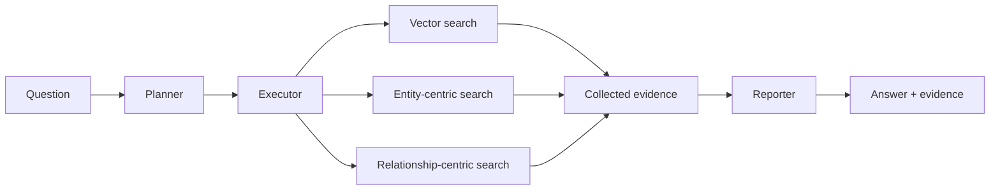

<h1 align="center">ModeRAG</h1>

<p align="center"><strong>结合向量与图检索的智能体问答框架。</strong></p>

<p align="center">
  <a href="https://huggingface.co/datasets/PKUfudawei/LHCpublications"></a>
  <a href="https://huggingface.co/datasets/PKUfudawei/AI4EIC2023"></a>
  <a href="pyproject.toml">=3.10"></a>
  <a href="LICENSE"></a>
</p>

<p align="center">
  <a href="README.md">English</a> · <strong>简体中文</strong>
</p>

## 目录

- [项目介绍](#项目介绍)
- [安装](#安装)
- [快速开始](#快速开始)
  - [1. 配置语言模型](#1-配置语言模型)
  - [2. 下载示例索引](#2-下载示例索引)
  - [3. 提问](#3-提问)
- [工作原理](#工作原理)
- [配置](#配置)
- [数据集](#数据集)
  - [为自己的文档建立索引](#为自己的文档建立索引)
- [评估](#评估)
- [仓库结构](#仓库结构)
- [文档](#文档)
- [许可证](#许可证)

---

## 项目介绍

ModeRAG 是一个 Python 框架：将问题拆成检索子任务，为每个子任务分配向量、实体中心或关系中心检索模式，再汇总检索证据生成回答。你可以用它探索文档集合、比较不同来源的信息，并查看回答所依据的证据。

- **任务规划：** 分解问题，为子查询分配检索模式。
- **向量与图检索：** 在同一索引语料中检索文本片段、实体和关系。
- **并行执行：** 按声明的依赖关系调度任务，并行执行独立子任务。
- **证据查看：** 查看检索内容、任务记录和报告中的结构化证据。
- **两种报告模式：** 支持简洁回答，以及带证据引用的详细报告。

## 安装

需要 Python 3.10 或更新版本。当前依赖包含 `faiss-gpu-cu12`，请使用兼容的 Linux/CUDA 环境。嵌入模型 `BAAI/bge-m3` 在本地运行，首次使用时可能需要下载模型权重。

```bash
git clone https://github.com/PKUfudawei/ModeRAG.git
cd ModeRAG
python -m venv .venv
source .venv/bin/activate
python -m pip install -e .
```
项目名称为 **ModeRAG**，Python 发行包名和导入包名均为 `moderag`。

## 快速开始

以下步骤均在仓库根目录、已激活的虚拟环境中执行。

### 1. 配置语言模型

设置 API 密钥和兼容 OpenAI 的模型端点：

```bash
export LLM_MODE=openai
export LLM_MODEL=gpt-4o-mini
export LLM_BASE_URL=https://api.openai.com/v1
export LLM_API_KEY="your-api-key"
```
使用其他兼容服务时，替换模型名称、端点地址和密钥。请显式设置 `LLM_MODE`，因为库的默认配置使用内部 Tencent 服务。

### 2. 下载示例索引

使用 [LHC Publications](https://huggingface.co/datasets/PKUfudawei/LHCpublications) 提供的向量和图索引。`hf` 命令由嵌入模型依赖链中的 `huggingface_hub` 提供。

```bash
hf download PKUfudawei/LHCpublications --repo-type dataset \
  --include "indexes/*" --local-dir ./data/lhcpublications
```
下载后，`data/lhcpublications/indexes/` 中应包含 `graph.pkl`、`entities.pkl`、`relationships.pkl` 和 `vectorstore/`。运行此示例无需下载完整文档语料。

### 3. 提问

将三种检索工具注册到下载的索引目录，再执行问答流程：

```python
from functools import partial

from moderag.agents import ReportMode, get_orchestrator
from moderag.agents.tools.registry import SearchModeTool, ToolRegistry

index_path = "./data/lhcpublications/indexes"
for mode in ("naive", "local", "global"):
    ToolRegistry.register(
        mode,
        partial(SearchModeTool, mode=mode, storage_path=index_path),
    )

orchestrator = get_orchestrator(report_mode=ReportMode.CONCISE)
result = orchestrator.process_query(
    "How do ATLAS and CMS study Higgs boson production?"
)

if not result.success:
    raise RuntimeError(result.error)

print(result.answer)
print(result.report.structured_evidence)
```
`result.plan` 包含任务计划；`result.to_dict()` 导出回答、报告、计划和执行统计。需要详细报告时，使用 `ReportMode.REASONING`。

工具注册在整个进程内生效，请在创建 orchestrator 之前完成配置。查询时使用的嵌入模型必须与构建索引时一致。

## 工作原理


| 阶段 | 职责 |
|---|---|
| Planner | 生成子查询、分配检索工具，并声明任务依赖。 |
| Executor | 并行执行就绪任务、重试失败任务，并收集检索证据。 |
| Reporter | 根据收集的证据生成回答和结构化报告。 |

| 检索模式 | API 名称 | 检索内容 |
|---|---|---|
| 向量检索 | `naive` | 与子查询相关的文本片段。 |
| 实体中心检索 | `local` | 实体、相邻图关系及支撑文本。 |
| 关系中心检索 | `global` | 相关关系及支撑文本。 |

子查询在执行前规划完成。依赖关系控制调度顺序，中间检索结果不会改写后续子查询。执行器也可以使用向量证据补充图检索结果。

## 配置

| 配置项 | 设置方式 |
|---|---|
| 模型服务配置 | 兼容 OpenAI 的服务使用 `LLM_MODE=openai`；内部服务使用 `tencent`。 |
| 模型与端点 | `LLM_MODEL`、`LLM_BASE_URL` 和 `LLM_API_KEY`；OpenAI 配置也接受 `OPENAI_API_KEY`。 |
| 索引目录 | 按快速开始示例，在注册 `SearchModeTool` 时绑定 `storage_path`。 |
| 检索数量 | 在 `SearchModeTool` 上设置 `recall_top_k`、`rerank_top_k`、`top_k_entities` 和 `top_k_relationships`。 |
| 可选重排模型 | 在 `SearchModeTool` 上设置 `reranker_model` 和 `reranker_device`；默认不加载重排模型。 |
| 报告格式 | `ReportMode.CONCISE` 或 `ReportMode.REASONING`。 |
| 并行任务数 | 将 `Executor(max_parallel_workers=4)` 传入 `Orchestrator(executor=...)`。 |

`get_llm()` 的显式参数优先于环境变量，环境变量优先于服务默认配置。

## 数据集

| 数据集 | 内容 |
|---|---|
| [LHC Publications](https://huggingface.co/datasets/PKUfudawei/LHCpublications) | ATLAS/CMS 文献语料，包含文档文本、图片和可下载索引，以及包含 100 道跨文档问题的 **LHCpubs-100QA** 问答基准。 |
| [AI4EIC2023](https://huggingface.co/datasets/PKUfudawei/AI4EIC2023) | AI4EIC2023 研讨会相关科学文献和示例问答集。 |

**LHC Publications** 指文献语料，**LHCpubs-100QA** 指其中的问答基准。语料和索引需要单独下载，不随代码分发。

### 为自己的文档建立索引

共享索引脚本读取 `<BENCH_ROOT>/corpus/<document-id>/*.md` 格式的 Markdown 文件，并将索引写入 `<BENCH_ROOT>/indexes/`：

```bash
BENCH_ROOT=./data/my_collection python benchmarks/common/build_index.py
```

脚本会切分文档，通过配置的语言模型提取实体和关系，并构建文本、实体和关系索引。此步骤会调用语言模型。索引生成后，按快速开始示例注册新目录。需要自定义文档加载方式时，参见 [GraphRAGIndexer](moderag/graphrag/indexer.py)。

## 评估

如需为少量 LHCpubs-100QA 问题生成回答，先将索引下载到基准目录：

```bash
hf download PKUfudawei/LHCpublications --repo-type dataset \
  --include "indexes/*" --local-dir ./benchmarks/LHCpubs_run2
```

沿用前面的模型环境配置，执行：

```bash
BENCH_ROOT=./benchmarks/LHCpubs_run2 \
BENCH_OUTPUT_DIR=./outputs/lhcpublications \
python benchmarks/common/run_benchmark.py \
  --tool-config all --max-questions 5
```
回答与检索上下文保存在 `outputs/lhcpublications/`。可以使用 `--tool-config naive`、`local`、`global` 或 `local+global` 选择其他工具组合。可选评分使用 Ragas：安装 `ragas` 和 `datasets` 后，添加 `--with-ragas`。评分也会调用模型。

更多参数见[共享运行脚本](benchmarks/common/run_benchmark.py)，问答集和脚本见[基准目录](benchmarks/)。

## 仓库结构

```text
moderag/
├── agents/       # Planner, Executor, Reporter, tools, evidence models
├── rag/          # Vector, BM25, and hybrid retrieval
├── graphrag/     # Graph construction and graph-based retrieval
└── models/       # LLM, embedding, reranker, and chunker adapters
benchmarks/
├── common/       # Shared indexing and evaluation scripts
├── AI4EIC2023/   # Example question set and runner
└── LHCpubs_run2/  # LHCpubs-100QA question set and runner
```
## 文档

- [智能体架构](moderag/agents/README.md)
- [知识图谱构建](moderag/graphrag/graph/README.md)
- [LHC Publications 数据集说明](https://huggingface.co/datasets/PKUfudawei/LHCpublications)

## 许可证

[MIT](LICENSE)。
